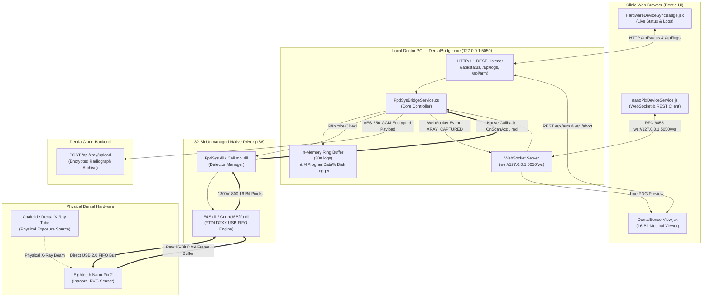
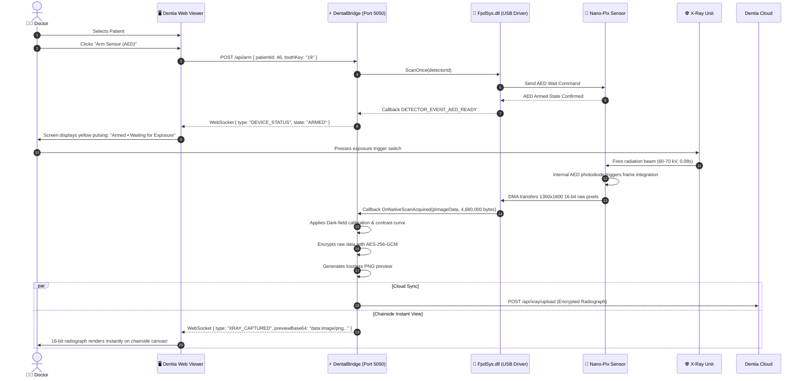
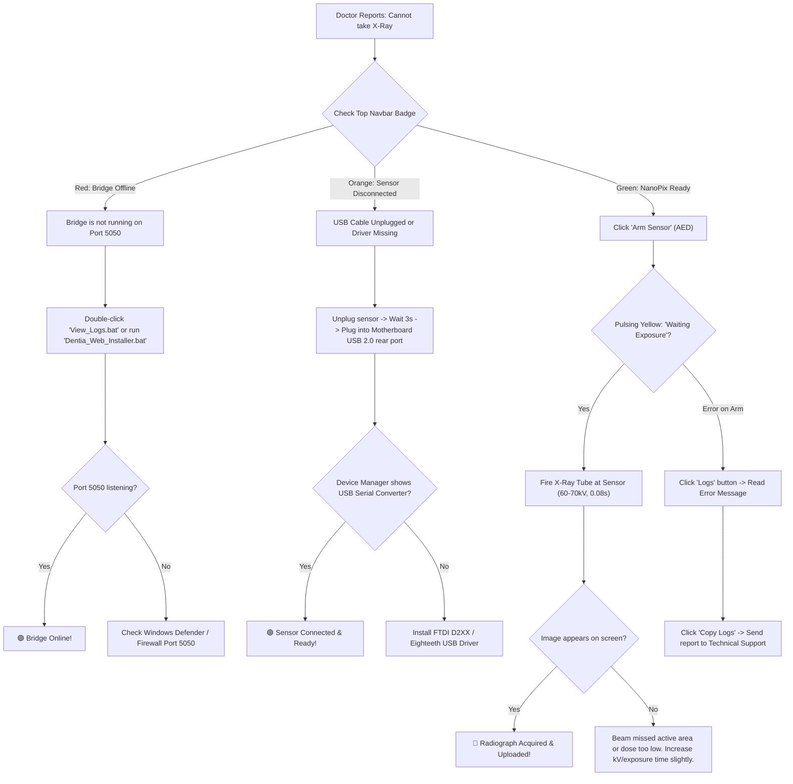

# Dentia Dental Hardware Bridge — Deployment, Architecture & Endpoint Specification

> **Version:** 2.4.0 (Production Release)  
> **Target Process Architecture:** Windows x86 (32-Bit Unmanaged Native Pipeline)  
> **Network Protocol:** HTTP/1.1 REST & RFC 6455 WebSockets  
> **Default Loopback Binding:** `http://127.0.0.1:5050` / `ws://127.0.0.1:5050/ws`  
> **Log Persistence:** `%ProgramData%\DentalBridge\logs\bridge_{yyyyMMdd}.log`  
> **Supported Sensors:** Eighteeth Nano-Pix 1.5, Nano-Pix 2, iRay / FpdSys E4S USB 2.0 FIFO Detectors  

---

## 1. Executive Summary & Purpose

The **Dentia Dental Hardware Bridge** (`DentalBridge.exe`) is an ultra-low-latency, self-contained Windows service designed to run on dental clinic doctor workstations. It bridges the modern web-based Dentia Radiology application (running on Chrome, Edge, or cloud Vercel HTTPS) directly to physical intraoral radiograph sensors plugged into the PC via USB.

Because web browsers run in secure sandboxes without native access to USB kernel drivers or unmanaged 32-bit C++ DLLs (`FpdSys.dll`, `E4S.dll`, `ConnUSBfifo.dll`), the bridge operates locally on `127.0.0.1:5050` to:
1. Initialize the 32-bit hardware SDK and maintain persistent USB device detection.
2. Listen for AED (Automatic Exposure Detection) arming commands from the web UI.
3. Stream raw 16-bit grayscale radiograph buffers (1300x1800 native matrix) from detector FIFO upon physical X-ray firing.
4. Execute dark-field calibration, AES-256-GCM encryption, and cloud transmission.
5. Provide continuous, transparent real-time diagnostic logging via REST APIs and WebSockets.

---

## 2. Process Architecture & Communication Diagrams

### 2.1 Complete System Architecture & Data Flow



---

### 2.2 Chairside Radiograph Acquisition Lifecycle



---

## 3. How to Verify Bridge & USB on Any Doctor's PC

### Step 1: Physical & Operating System Level Check
1. **USB Port Attachment**:
   - Plug the Eighteeth Nano-Pix sensor directly into a **rear motherboard USB 2.0 or 3.0 port** (avoid unpowered USB hubs or keyboard passthroughs).
   - Sensor LED should turn solid Green/Blue.
2. **Device Manager Verification**:
   - Press `Win + X` -> Click **Device Manager**.
   - Expand **Universal Serial Bus controllers**:
     - You should see: `USB Serial Converter` (FTDI) or `E4S Digital Radiography Detector`.
     - No yellow exclamation marks (`⚠️`).

---

### Step 2: Bridge Service & Port 5050 Verification
Run this single command in **PowerShell** on the doctor's PC:

```powershell
Get-NetTCPConnection -LocalPort 5050 -State Listen | Select-Object LocalAddress, LocalPort, State, OwningProcess
```

**Expected Output:**
```text
LocalAddress LocalPort  State OwningProcess
------------ ---------  ----- -------------
127.0.0.1         5050 Listen          4128
```

You can also test the port via `Test-NetConnection`:
```powershell
Test-NetConnection -ComputerName 127.0.0.1 -Port 5050
```
**Expected Output:** `TcpTestSucceeded : True`

---

### Step 3: Browser Direct Diagnostic URL (Instant Visual Check)
Open Google Chrome or Microsoft Edge on the doctor's PC and navigate to:
```text
http://127.0.0.1:5050/api/status
```

**Expected JSON Response:**
```json
{
  "bridgeOnline": true,
  "port": 5050,
  "listenAddress": "http://127.0.0.1:5050",
  "wsAddress": "ws://127.0.0.1:5050/ws",
  "connected": true,
  "usbConnected": true,
  "model": "Eighteeth Nano-Pix 2 (HD CMOS)",
  "serialNumber": "iRayC7DB5M40P4",
  "state": "READY",
  "status": "Ready",
  "isArmed": false,
  "activeClients": 1,
  "logCount": 42,
  "logFile": "C:\\ProgramData\\DentalBridge\\logs\\bridge_20261011.log",
  "driver": "FpdSys.dll Active (x86)",
  "timestamp": "2026-10-11T14:35:10.120Z"
}
```

#### Meaning of Fields:
- `"bridgeOnline": true` -> C# Bridge process is active and running.
- `"usbConnected": true` -> Unmanaged C++ driver (`FpdSys.dll`) detected and opened the USB sensor.
- `"state": "READY"` -> Sensor is in chairside standby, ready to be armed.

---

### Step 4: Frontend UI Visual Indicators

| Visual Element | Location | Status Indicator | Meaning |
| :--- | :--- | :--- | :--- |
| **Sync Pill** | Top Navbar | 🟢 **Green** (`NanoPix Ready`) | Bridge is online on port 5050 and USB is physically attached. |
| **Sync Pill** | Top Navbar | 🔴 **Red** (`Bridge Offline`) | Bridge service is not running. Doctor can click "1-Click Bridge Setup". |
| **Sync Pill** | Top Navbar | 🟠 **Orange** (`Sensor Disconnected`) | Bridge is running, but USB cable is unplugged. |
| **Ping 5050** | Sync Badge Modal | `🟢 14ms • USB: Connected` | Confirms real-time round-trip latency to the local bridge. |
| **Live Stepper** | Sync Badge Modal | Steps 1 through 5 green lights | Confirms Arming -> Exposure -> Reception -> Chart Mount -> AI Analysis. |

---

## 4. Complete REST & WebSocket Endpoint Specification

The bridge listens on loopback IP `127.0.0.1` and `localhost` at **Port 5050**. All responses include permissive CORS headers:
- `Access-Control-Allow-Origin: *`
- `Access-Control-Allow-Methods: GET, POST, OPTIONS`
- `Access-Control-Allow-Headers: Content-Type, Authorization`

---

### 4.1 `GET /api/status` — Comprehensive Health & Endpoint Directory

* **Purpose:** Primary diagnostic probe used by the frontend to detect bridge presence, USB hardware status, and available routes.
* **HTTP Method:** `GET`
* **Response Code:** `200 OK`
* **Response Body (JSON):**
```json
{
  "bridgeOnline": true,
  "port": 5050,
  "listenAddress": "http://127.0.0.1:5050",
  "wsAddress": "ws://127.0.0.1:5050/ws",
  "connected": true,
  "usbConnected": true,
  "model": "Eighteeth Nano-Pix 2 (HD CMOS)",
  "serialNumber": "iRayC7DB5M40P4",
  "state": "READY",
  "status": "Ready",
  "isArmed": false,
  "activeClients": 1,
  "logCount": 18,
  "logFile": "C:\\ProgramData\\DentalBridge\\logs\\bridge_20261011.log",
  "driver": "FpdSys.dll Active (x86)",
  "timestamp": "2026-10-11T14:40:00.000Z",
  "endpoints": [
    { "path": "/api/status", "method": "GET", "status": "200 OK", "description": "Bridge health check, USB status & endpoint registry" },
    { "path": "/api/logs", "method": "GET", "status": "200 OK", "description": "Live in-memory ring-buffer diagnostic event logs" },
    { "path": "/api/logs/clear", "method": "POST", "status": "200 OK", "description": "Clear active in-memory log entries" },
    { "path": "/api/arm", "method": "POST", "status": "200 OK", "description": "Arm intraoral sensor for X-ray exposure (alias: /nanopix/arm-sensor)" },
    { "path": "/api/abort", "method": "POST", "status": "200 OK", "description": "Abort active sensor AED arming cycle (alias: /nanopix/abort)" },
    { "path": "/api/diagnostic", "method": "GET", "status": "200 OK", "description": "Direct hardware probe & USB sensor ping" },
    { "path": "/nanopix/status", "method": "GET", "status": "200 OK", "description": "Frontend backward compatibility status endpoint" },
    { "path": "/ws", "method": "UPGRADE", "status": "101 Switching Protocols", description: "Real-time WebSocket event streaming" }
  ]
}
```

---

### 4.2 `GET /api/logs` — Live Ring-Buffer Event Log Ingestion

* **Purpose:** Retrieves the most recent 300 chronological hardware and system diagnostic logs.
* **HTTP Method:** `GET`
* **Response Code:** `200 OK`
* **Response Body (JSON):**
```json
{
  "success": true,
  "bridgeOnline": true,
  "total": 3,
  "logFilePath": "C:\\ProgramData\\DentalBridge\\logs\\bridge_20261011.log",
  "logs": [
    {
      "Id": 1,
      "Timestamp": "14:41:02",
      "Level": "SUCCESS",
      "Category": "HARDWARE",
      "Message": "Eighteeth Detector Initialized! DetectorID=0, Serial=iRayC7DB5M40P4",
      "Details": null
    },
    {
      "Id": 2,
      "Timestamp": "14:41:05",
      "Level": "SUCCESS",
      "Category": "WEBSOCKET",
      "Message": "React client connected! ID=9a3c... (Total active sessions: 1)",
      "Details": null
    },
    {
      "Id": 3,
      "Timestamp": "14:41:10",
      "Level": "INFO",
      "Category": "API",
      "Message": "[REQUEST] GET '/api/logs' -> Delivered 3 log entries (200 OK)",
      "Details": null
    }
  ]
}
```

---

### 4.3 `POST /api/logs/clear` — Clear In-Memory Console Buffer

* **Purpose:** Resets the in-memory ring-buffer when a doctor or developer clicks "Clear Logs" on the frontend. Disk files remain intact for historical auditing.
* **HTTP Method:** `POST`
* **Response Code:** `200 OK`
* **Response Body (JSON):**
```json
{
  "success": true,
  "message": "Logs cleared successfully"
}
```

---

### 4.4 `POST /api/arm` (Alias: `/nanopix/arm-sensor`) — Arm Sensor for AED Capture

* **Purpose:** Instructs the physical sensor to enter AED acquisition mode, waiting for radiation pulses.
* **HTTP Method:** `POST`
* **Headers:** `Content-Type: application/json`
* **Request Body (JSON):**
```json
{
  "patientId": 46,
  "toothKey": "19",
  "doctorId": 12
}
```
* **Response Code:** `200 OK` (when armed) or `500 Internal Server Error` (if hardware disconnected)
* **Response Body (Success):**
```json
{
  "success": true,
  "armed": true,
  "patientId": 46,
  "toothKey": "19"
}
```

---

### 4.5 `POST /api/abort` (Alias: `/nanopix/abort`) — Disarm Sensor

* **Purpose:** Cancels an active AED wait state if the doctor cancels or re-positions the sensor.
* **HTTP Method:** `POST`
* **Response Code:** `200 OK`
* **Response Body:**
```json
{
  "success": true,
  "armed": false
}
```

---

### 4.6 `GET /api/diagnostic` — Hardware Ping & Verification

* **Purpose:** Performs a low-level probe of the detector state via `GetDetectorStatus()`.
* **HTTP Method:** `GET`
* **Response Code:** `200 OK`
* **Response Body:**
```json
{
  "success": true,
  "hardwareConnected": true,
  "model": "Eighteeth Nano-Pix 2 (HD CMOS)",
  "serial": "iRayC7DB5M40P4"
}
```

---

### 4.7 `GET /nanopix/status` — Legacy Frontend Compatibility

* **Purpose:** Fallback route queried by legacy client hooks.
* **HTTP Method:** `GET`
* **Response Code:** `200 OK`
* **Response Body:**
```json
{
  "bridgeOnline": true,
  "usbConnected": true,
  "model": "Eighteeth Nano-Pix 2 (HD CMOS)",
  "serialNumber": "iRayC7DB5M40P4",
  "status": "Ready",
  "port": 5050,
  "listenAddress": "http://127.0.0.1:5050",
  "wsAddress": "ws://127.0.0.1:5050/ws",
  "timestamp": "2026-10-11T14:45:00.000Z"
}
```

---

### 4.8 `UPGRADE /ws` — Real-Time WebSocket Event Stream

* **URL:** `ws://127.0.0.1:5050/ws`
* **Sub-protocol:** `null`
* **Inbound (Client -> Bridge):**
  - `{ "action": "PING" }` -> Bridge responds with `{ "type": "PONG" }`
  - `{ "action": "ARM", "patientId": 46, "toothKey": "19" }`
  - `{ "action": "ABORT" }`
* **Outbound (Bridge -> Client Broadcast):**
  1. **Log Stream:**
     ```json
     {
       "type": "LOG",
       "log": {
         "Id": 24,
         "Timestamp": "14:46:12",
         "Level": "INFO",
         "Category": "ARM",
         "Message": "Arming NanoPix sensor for Patient #46, Tooth #19...",
         "Details": null
       }
     }
     ```
  2. **Device Status Change:**
     ```json
     {
       "type": "DEVICE_STATUS",
       "connected": true,
       "model": "Eighteeth Nano-Pix 2 (HD CMOS)",
       "serial": "iRayC7DB5M40P4",
       "state": "ARMED",
       "isArmed": true,
       "patientId": 46,
       "toothKey": "19"
     }
     ```
  3. **Radiograph Captured (Physical Exposure Event):**
     ```json
     {
       "type": "XRAY_CAPTURED",
       "capturedAt": "2026-10-11T14:46:25.100Z",
       "toothKey": "19",
       "patientId": 46,
       "width": 1300,
       "height": 1800,
       "bitsAllocated": 16,
       "previewBase64": "data:image/png;base64,iVBORw0KGgoAAAANSUhEUgAABV..."
     }
     ```

---

## 5. Troubleshooting Decision Tree for Doctors & IT Admins



---

## 6. Physical File & Directory Reference

| File / Folder | Role & Location |
| :--- | :--- |
| **`DentalBridge.exe`** | Compiled 32-bit (x86) background service executable. |
| **`C:\ProgramData\DentalBridge\logs\`** | Persistent folder where daily log files (`bridge_YYYYMMDD.log`) are stored. |
| **`InstallDentalBridge.bat`** | Windows Admin installation script that sets up startup autorun and firewall rules. |
| **`View_Logs.bat`** | Doctor PC Desktop shortcut to monitor real-time PowerShell log stream. |
| **`Dentia_Web_Installer.bat`** | Browser-downloadable 1-click self-contained installer. |
| **`FpdSys.dll`, `E4S.dll`, `ConnUSBfifo.dll`** | Native 32-bit hardware drivers bundled inside `publish\`. |

---
*Documentation compiled and verified for Dentia Medical Imaging Cloud Suite.*
