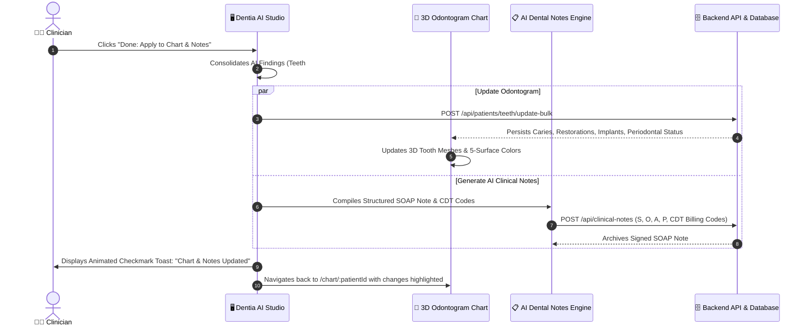

# Dentia AI Diagnostic & Treatment Studio: Architecture & Implementation Blueprint

> **Executive Overview**  
> This specification documents the end-to-end design, component architecture, and integration roadmap to build the **Dentia AI Diagnostic & Treatment Studio** exactly matching the reference interface.  
> When AI analysis completes—whether triggered from hardware devices (**Soredex Digora Optime**, **NanoPix RVG**) or direct **X-ray / CBCT image uploads**—this interface launches with cinematic clinical animations. When the doctor clicks **"Done (Apply Changes)"**, all detected pathologies are automatically applied to the patient's **3D Odontogram Chart** and a structured **AI Clinical SOAP Note** is generated and archived in one seamless step.

---

## 1. Visual & Architectural Decomposition of the Reference Interface

```
+-------------------------------------------------------------------------------------------------------------------------------+
| DENTIA AI                     [Features] [Education]      [Scan Type: OPG] [Jaw: Mandible] [Region: Anterior]    (+) (🔔) [Doctor Dr. Jhangir Ahmed] |
+---+-----------------------------------------------------------------------------------------------------------+---------------+
|   |  [Tooth 7.9 | Upper | (11%)]      [Tooth 12 | Lower | (23%)]     [Tooth 27 | Upper | (67%)]     [Tooth 6.17 | Lower | (76%)]  |
| L |  "Upper Panel Tooth 7.9"          "Lower Panel Tooth 12"         "Down Panel Tooth 27"          "Lower Panel Tooth 6.17"  |
| E |  "Need To Be: Implants"           "Need To Be: Gingivitis"       "Need To Be: Root Cavity"      "Need To Be: Periodontitis"|
| F +-----------------------------------------------------------------------------------------------------------+---------------+
| T |  [3D View]  [Reset Filter]  [Magnify]  [Inverter]  [Contrast]  [Brightness]  [Reload]  [Transform]        | HEALTH GPT    |
|   +-----------------------------------------------------------------------------------------------------------+ (Copilot)     |
| R |                                                                                                           | User & AI     |
| A |                          INTERACTIVE 3D JAW & AI ANNOTATED VIEWPORT                                       | Chat Dialogue |
| I |                                                                                                           |               |
| L |                (7.9) Bone Pathology 🏷️                   (27) Cavity 🏷️                                  | Quick Chips:  |
|   |                                                                                                           | [Post-Op Care]|
| I |                                                                                                           | [Schedule]    |
| C |                (27) Implant Planned 🏷️                  (6.17) Decay & Tooth Wear 🏷️                     | [Past History]|
| O |                                                                                                           | [Enter Msg...] |
| N |  [X-Ray Overview] [Tooth Health] [✨ AI analyze] [Bone & Gum Health] [Structure & Alignment] [more >]      +---------------+
| S +-----------------------------------------------------------------------------------------------------------+ AI SUGGESTS   |
|   |   [ Left Sagittal Angle ]     [ Coronal Arch Spotlight ]     [ Right Sagittal Angle ]                     | 1. Cleaning   |
|   |   (Teal Glow Marker)          (Blue Glow Marker)             (Coral Glow Marker)                          | 2. Cavity Fill|
|   |   (• • • •)                                                                      [← Prev]  [Next →]       | [DONE: APPLY] |
+---+-----------------------------------------------------------------------------------------------------------+---------------+
```

---

## 2. Core Functional Modules

### A. Hardware & Image Upload Ingestion Layer
The studio seamlessly receives image data from three distinct clinical workflows:
1. **Soredex Digora Optime Phosphor Plate Scanner:**
   - Captured via `DigoraHardwareBridge` / TWAIN emulator or LAN socket (`digora_lan_bridge.cjs`).
   - Emits custom event `dentia:device:capture-complete` with high-resolution 16-bit radiograph.
2. **NanoPix RVG CMOS Sensor:**
   - Direct real-time intraoral snapshot with auto-exposure and calibration filter.
3. **Manual File Drag-and-Drop / Upload:**
   - Accepts DICOM (.dcm), high-res JPEG, PNG, TIFF, or Panoramic OPG scans.
4. **Cinematic Pre-Processing Neural Animation:**
   - Laser scanner line traversing the radiograph with teal/cyan illumination.
   - Dynamic clinical stage indicator:
     - `Step 1/3: Enhancing dynamic range & edge contrast...`
     - `Step 2/3: Neural detection of 32 teeth, crowns, roots & alveolar crest...`
     - `Step 3/3: Segmenting caries, bone loss, furcation defects & impactions...`

---

### B. Diagnostic Ring Gauges & Summary Cards
At the top of the interface, four high-priority clinical findings are rendered:
- **Tooth Identifier:** Specific tooth notation (FDI, Universal, or Multi-tooth cluster e.g., `Tooth 7.9`, `Tooth 12`, `Tooth 27`, `Tooth 6.17`).
- **Jaw Position:** `Upper` (Maxilla) or `Lower` (Mandible).
- **SVG Ring Progress Gauge:**
  - Red / Coral (`11%` - High Urgency / Implantation).
  - Electric Blue (`23%` - Gingivitis / Soft Tissue).
  - Sky Blue / Teal (`67%` - Root Caries / Endodontic involvement).
  - Multi-tone Gradient (`76%` - Severe Periodontitis / Alveolar resorption).
- **Severity & Recommendation Subtitle:** Instant clinical takeaway for the doctor.

---

### C. Advanced Radiographic Viewport Toolbar
8 live manipulation controls operating directly on the Canvas / WebGL context:
1. **3D View:** Toggle between 2D X-Ray overlay and interactive Three.js 3D Jaw Mesh.
2. **Reset Filter:** Instant return to default optical balance.
3. **Magnify:** 2.5x circular chairside magnifying loupe with drag support.
4. **Inverter:** Negative film inversion (reveals subtle radiolucencies and micro-fractures).
5. **Contrast (`Contraste`):** Real-time gamma curve slider (50% to 200%).
6. **Brightness:** Luminance normalization slider.
7. **Reload:** Re-fetches the original raw scan from DICOM source.
8. **Transform:** Horizontal flip (mirror view) and 90° rotation.

---

### D. Interactive 3D Jaw & AI Pinpoint Badges
- **Interactive Three.js 3D Jaw Arch Model:**
  - Full orbital rotation, pinch-to-zoom, and smooth panning.
  - Anatomical teeth models with real dental textures and translucency.
- **Glowing AI Pinpoint Markers:**
  - Floating 3D badges connected to specific teeth via subtle leader lines:
    - 🟡 **Bone Pathology** (Yellow/Gold Badge)
    - 🔵 **Cavity / Active Caries** (Cobalt Blue Badge)
    - 🟢 **Implant Planned / Recommended** (Teal Badge)
    - 🔴 **Decay / Tooth Wear / Attrition** (Coral Badge)
  - Clicking any badge spotlights that specific tooth, pulls up its diagnostic confidence score (e.g., `98.4% AI Confidence`), and syncs the Right Sidebar.
- **Diagnostic Modes Navigation Bar:**
  - `X-Ray Overview` | `Tooth Health` | `✨ AI analyze` | `Bone & Gum Health` | `Structure & Alignment` | `more >`
- **Multi-Angle Mini Filmstrip:**
  - Left Sagittal, Coronal Dual-Arch, and Right Sagittal snapshots with color-coded detection heatmaps.
  - Carousel navigation dots (`• • • •`) and `Prev` / `Next` buttons.

---

### E. Health GPT Copilot (Right Sidebar)
- **Natural Language Clinical Assistant:**
  - Allows the dentist to ask: *"What CDT codes should be billed for tooth 27 and 6.17?"*, *"Generate patient explanation for bone grafting on tooth 7.9"*, etc.
- **Quick Clinical Action Chips:**
  - `[Post-Treatment Care]`
  - `[Schedule Appointment]`
  - `[Past Medical History]`
  - `[Dental Procedures]`
- **AI Suggests Section:**
  - Prioritized list of required treatments:
    - `1. Book Cleaning` (Urgent Tag)
    - `2. Fill Cavity` (Soon Tag)
    - `3. Surgical Implant Assessment` (Planned Tag)

---

## 3. The 1-Click "Done (Apply Changes)" Workflow

When the doctor reviews the findings and clicks **`Done: Apply to Chart & Notes ➔`**:



---

## 4. Technical Stack & Implementation Details

| Module | Technologies | Key Responsibilities |
|---|---|---|
| **View Controller** | React 18, React Router v7 | Seamless route `/chart/:patientId/ai-studio` and modal drawer overlay |
| **3D Jaw Rendering** | Three.js, `@react-three/fiber` | Dual jaw anatomical rendering, orbit controls, tooth spotlighting |
| **DICOM / X-Ray Filters** | HTML5 Canvas, WebGL Shader | Inversion, contrast, gamma, sharpness, magnification loupe |
| **Ring Gauges** | SVG Circle Dasharray | Animated radial progress with tailored clinical gradients |
| **AI LLM Copilot** | Groq LLM API (`dentiaJarvisService`) | Clinical question answering, patient explanation generation |
| **Database Sync** | REST API (`/api/patients/teeth/update-bulk`) | Immediate persistence of clinical findings to PostgreSQL/SQL Server |
| **SOAP Generator** | Structured Clinical Scribe Engine | Generates compliant dental notes with CDT D2391, D6010, D4341 |

---

## 5. Proposed File Architecture

```
f:\DentistApp_Theme2\Dentistfrontend\src\
├── modules\
│   └── aiRadiologyStudio\
│       ├── pages\
│       │   └── DentiaAIRadiologyStudioPage.jsx    <-- Main Fullscreen Studio
│       ├── components\
│       │   ├── StudioTopNavBar.jsx               <-- Search filters, profile, actions
│       │   ├── DiagnosticRingCards.jsx           <-- 4 Top KPI Cards with SVG gauges
│       │   ├── RadiographToolbar.jsx             <-- 8 image manipulation buttons
│       │   ├── ThreeRadiologyJawViewer.jsx       <-- 3D WebGL Jaw with AI callout pins
│       │   ├── AngleFilmstripCarousel.jsx        <-- Multi-angle thumbnail views
│       │   ├── HealthGPTChatDrawer.jsx           <-- Right-hand chat copilot
│       │   └── AISuggestionsActionPanel.jsx      <-- AI Suggests & "Done: Apply" button
│       └── services\
│           ├── radiologyFilterEngine.js          <-- Canvas WebGL image processing
│           └── aiFindingsApplierService.js       <-- 1-Click sync to Chart & AI Notes
```

---

## 6. Doctor Workflow Demonstration

1. **Patient in Operatory:** Doctor opens Patient Chart `/chart/38`.
2. **Imaging Trigger:** Doctor clicks *"Arm NanoPix Sensor"*, *"Connect Digora Scanner"*, or *"Import X-Ray"*.
3. **Capture & Analyze:** Radiograph is captured ➔ AI scans image with animated laser pulse.
4. **Review in Studio:** The **Dentia AI Studio** opens with:
   - High-res 3D annotated jaw.
   - Pinned callout badges for Bone Pathology, Cavity, Implants, and Periodontitis.
   - Diagnostic ring cards (`11%`, `23%`, `67%`, `76%`).
   - Health GPT ready with treatment recommendations.
5. **Apply & Finalize:** Doctor clicks **`Done (Apply Changes) ➔`**.
   - Odontogram updates in real-time.
   - SOAP Note is signed and saved in AI Notes.
   - Doctor is returned to the Patient Chart with zero friction.

---

> [!NOTE]  
> **Status:** Specification created as requested. Ready to proceed with implementation whenever you give the signal!
