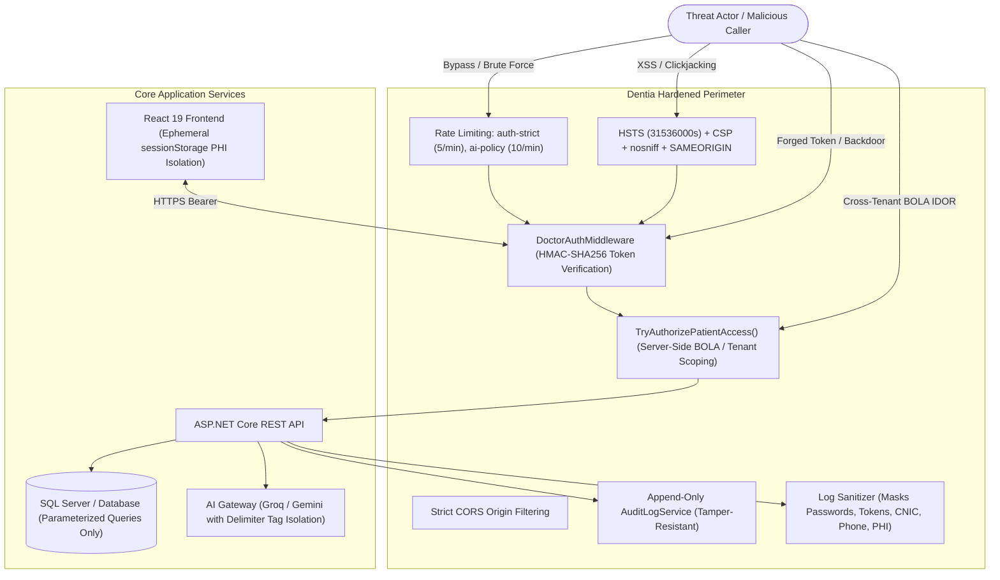
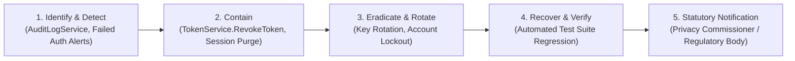

# Dentia Practice Management Platform — Security Policy & Technical Hardening Guide

> **Document Version:** 2.0 (OWASP Hardened)  
> **Status:** Production-Ready  
> **Classification:** Confidential — Dental Clinical Engineering

---

## 1. Threat Model & Security Posture Summary

The "Dentia" practice management platform operates in a multi-tenant healthcare environment handling Protected Health Information (PHI), Personally Identifiable Information (PII), and financial billing records. The threat model addresses attack surfaces across the web frontend, REST API services, diagnostic hardware bridges, and external AI gateways:



---

## 2. Implemented Security Controls

### 2.1 Authentication & Session Management
- **Backdoor Removal (SEC-VULN-01):** The hardcoded development token (`fake-jwt-token`) has been completely removed from `TokenService.cs`. All tokens require HMAC-SHA256 signature verification against a 256-bit cryptographically secure key.
- **Short-Lived Access Tokens (SEC-VULN-06):** Doctor access tokens expire in **120 minutes** (configured via `Jwt:DoctorExpiryMinutes`), and Patient tokens expire in **240 minutes** (configured via `Jwt:PatientExpiryMinutes`).
- **Token Invalidation on Logout (SEC-VULN-06):** Implemented `RevokeToken()` denylist in `TokenService.cs` backed by a bounded thread-safe concurrent dictionary. Calling `POST /api/auth/logout` invalidates the bearer token immediately.
- **Idle Session Timeout:** 10-minute continuous inactivity sliding timeout enforced client-side (`sessionSecurityService.js`), synchronizing session termination across all browser tabs via `BroadcastChannel`.
- **Query-String Token Restriction (SEC-VULN-07):** Tokens in URL query parameters (`?token=` or `?access_token=`) are strictly prohibited across all clinical and billing endpoints, and are accepted only on read-only radiograph image streaming GET requests (`/api/radiographs/{id}/image`).

### 2.2 Authorization & Access Control (BOLA / IDOR Defense)
- **Deny-by-Default:** All `/api/*` routes require active authenticated tokens unless explicitly declared in the public route whitelist.
- **Server-Side Tenant Scoping (SEC-VULN-03):** Implemented `TryAuthorizePatientAccess(patientId)` in `PatientsController.cs`.
  - SuperAdmins have global oversight.
  - Doctors have clinical access to patient files.
  - Patients are strictly constrained to their own record (`PatientId == targetId`). Cross-patient access attempts return HTTP 403 Forbidden and generate an immediate `BOLA_ACCESS_DENIED` security alert.
- **Role-Based Endpoint Matrix:** Complete endpoint permissions mapped and documented in [`PERMISSIONS_MATRIX.md`](file:///f:/DentistApp_Theme2/PERMISSIONS_MATRIX.md).

### 2.3 Sensitive Data Protection & Storage Isolation
- **Configuration Secrets Externalization (SEC-VULN-02):** Plaintext database passwords, SMTP credentials, and AI provider API keys have been sanitized from committed `appsettings.json` templates, with runtime overrides loaded from environment variables (`JWT_SECRET_KEY`, `ConnectionStrings__DefaultConnection`, `GEMINI_API_KEY`, `GROQ_API_KEY`).
- **Ephemeral Clinical Storage (SEC-VULN-05):** All client-side clinical dossiers, patient directories, 3D jaw assessments, periodontal probing depths, biopsy reports, implant plans, and radiograph Data URLs have been migrated from persistent `localStorage` to ephemeral `sessionStorage` (`clinicalStorageService.js`).
- **Atomic Session Purge:** On user logout or session timeout, `clinicalStorage.purgeAllClinicalData()` wipes all cached PHI from browser memory and storage.
- **Audit Logging (SEC-VULN-09):** Append-only `AuditLogService` records all patient demographics views, chart loads, PDF exports, prescription queries, and BOLA denials in `logs/audit_access_YYYY-MM-DD.log`.
- **Log Sanitization (SEC-VULN-04):** `ApiRequestLoggingMiddleware.cs` and `DatabaseDiagnosticObserver.cs` redact sensitive fields (`password`, `token`, `accessToken`, `cnic`, `phone`, `medicalHistory`, `medicalNotes`, `transcript`) before writing to disk.

### 2.4 Browser & Perimeter Security
- **Content Security Policy (SEC-VULN-08):** Injected strict `Content-Security-Policy` header restricting script, style, image, font, and frame-ancestors directives.
- **HTTP Strict Transport Security (HSTS):** Enforced `Strict-Transport-Security: max-age=31536000; includeSubDomains`.
- **MIME & Framing Protections:** `X-Content-Type-Options: nosniff`, `X-Frame-Options: SAMEORIGIN`, `Referrer-Policy: strict-origin-when-cross-origin`, `X-XSS-Protection: 0`.

### 2.5 AI Safety & Clinical Telemetry
- **Backend-Only AI Keys:** AI provider API keys (Groq, Google Gemini) are held exclusively on the server; the frontend never connects to external AI services directly.
- **Delimiter Tag Isolation:** Clinical transcripts and notes are wrapped in XML delimiters (`<clinical_transcript>`) to isolate inputs against prompt injection attacks.
- **Rate Limiting:** `[EnableRateLimiting("ai-policy")]` enforces 10 requests per minute per IP to prevent resource exhaustion and cost-abuse.

---

## 3. Incident Response Protocol

In the event of a suspected credential leak, unauthorized access attempt, or data breach:



1. **Identification:** Inspect `logs/audit_access_YYYY-MM-DD.log` for anomalous read spikes or `BOLA_ACCESS_DENIED` events. Check `logs/all_activities_YYYY-MM-DD.log` for 401/403/429 patterns.
2. **Containment:**
   - Invalidate compromised doctor or patient tokens via the backend revocation list or by restarting the API service to flush in-memory keys.
   - Temporarily disable affected clinician accounts via `PUT /api/auth/doctors/{id}/status` (`isActive = false`).
3. **Eradication & Rotation:**
   - Follow the Key Rotation Process (Section 4) below immediately.
   - Force password resets for affected users.
4. **Recovery & Verification:**
   - Run the automated security verification suite (`npm test`) to confirm zero regressions.
   - Restore database from clean verified backup if tampering occurred.
5. **Statutory Notification:**
   - Depending on practice jurisdiction, report breaches of unencrypted PHI/PII to the relevant supervisory authority (e.g. Office of the Privacy Commissioner in NZ within 72 hours, HHS OCR in the US, or local regulators).

---

## 4. Key Rotation Process

### 4.1 JWT Secret Key Rotation
1. Generate a new 256-bit (32+ byte) cryptographically secure random string:
   ```bash
   openssl rand -base64 48
   ```
2. Update the environment variable on the application host:
   ```bash
   export JWT_SECRET_KEY="<new-secure-key>"
   ```
3. Restart the ASP.NET Core service. All existing issued tokens will be invalidated immediately, requiring users to log in with fresh credentials.

### 4.2 Database Credential Rotation
1. Create a new SQL Server user with minimum necessary permissions:
   ```sql
   CREATE LOGIN [dentia_app_user] WITH PASSWORD = '<StrongPassword>';
   CREATE USER [dentia_app_user] FOR LOGIN [dentia_app_user];
   ALTER ROLE [db_datareader] ADD MEMBER [dentia_app_user];
   ALTER ROLE [db_datawriter] ADD MEMBER [dentia_app_user];
   ```
2. Update `ConnectionStrings__DefaultConnection` environment variable on the server.
3. Drop or disable the legacy database user.

### 4.3 AI Provider API Key Rotation
1. Log in to Groq Console (`console.groq.com`) or Google Cloud AI Console (`aistudio.google.com`).
2. Generate a new API key.
3. Update `GROQ_API_KEY` and `GEMINI_API_KEY` environment variables.
4. Revoke the old keys in the respective provider dashboards.

---

## 5. Residual Risk Assessment & Compliance Review

While technical hardening mitigates the primary OWASP application vulnerabilities, technical controls must be supported by operational practice policies:

| Residual Risk Vector | Risk Level | Mitigation & Operational Recommendation |
| :--- | :---: | :--- |
| **Physical Workstation Shoulder-Surfing** | Medium | Clinicians must lock workstations (`Win + L`) when stepping away from the operatory chair. Idle timeout provides 10-minute fallback. |
| **Database Encryption at Rest (TDE)** | Low-Medium | Ensure Transparent Data Encryption (TDE) is activated on the host SQL Server instance for all clinical database files (`.mdf`/`.ldf`). |
| **Third-Party AI Cloud Retention** | Low | Confirm that your enterprise AI API contract with Google/Groq specifies a **Zero Data Retention (ZDR)** policy for patient health data. |
| **Static File Upload Storage** | Low | Radiographs in `wwwroot/uploads` should be migrated to private cloud object storage (e.g. Azure Blob with Private Endpoints and SAS tokens) in multi-clinic deployments. |

> [!NOTE]
> **Legal Compliance Review Requirement:**  
> This application hardening pass provides defensive technical safeguards. Practice owners must retain qualified legal counsel to perform formal privacy impact assessments under:
> - **New Zealand**: Health Information Privacy Code 2020 (HIPC) & Privacy Act 2020.
> - **United States**: Health Insurance Portability and Accountability Act (HIPAA) Security Rule (45 CFR § 164.312).
> - **European Union**: GDPR Art. 9 & Art. 32 Technical and Organisational Measures.
> - **Pakistan**: Prevention of Electronic Crimes Act (PECA 2016) & draft Personal Data Protection Bill.
