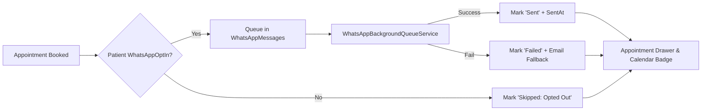

# 📱 Dentia: WhatsApp Delivery Feedback, Conditional Phone Intake, & AI Voice Integration Specification

**Version:** 1.0.0  
**Date:** October 19, 2026  
**Status:** Approved for Implementation  
**Target Repositories:**  
- Backend: `DentistAPI` & `DentistAPIClone\API_dentist`
- Frontend: `Dentistfrontend`
- Tests: `tests/`

---

## 1. Executive Summary & Problem Statement

This specification addresses four critical operational requirements identified from real-world clinic workflows and UI audit:

```
┌─────────────────────────────────────────────────────────────────────────────────────────────────┐
│                                CLINICAL WORKFLOW CHALLENGES                                     │
├────────────────────────────────┬────────────────────────────────────────────────────────────────┤
│ 1. Delivery Blindspot           │ When an appointment is booked on the calendar, the receptionist│
│                                │ has no immediate visual confirmation of whether WhatsApp was   │
│                                │ dispatched, queued, or skipped due to patient opt-out.         │
├────────────────────────────────┼────────────────────────────────────────────────────────────────┤
│ 2. Unsafe Default & Missing    │ WhatsApp was previously default-on, which risked sending       │
│    Validation                  │ messages to patients without explicit consent. Furthermore,     │
│                                │ phone numbers were not conditionally enforced when WhatsApp    │
│                                │ was actively enabled.                                          │
├────────────────────────────────┼────────────────────────────────────────────────────────────────┤
│ 3. AI Intake Disconnect        │ The "Smart Patient Intake" AI assistant (Voice & Chat) did not │
│                                │ capture or prompt for WhatsApp preferences during conversational│
│                                │ registration.                                                  │
├────────────────────────────────┼────────────────────────────────────────────────────────────────┤
│ 4. Directory Status Visibility │ Clinic staff need immediate, filterable visibility in the      │
│                                │ Patient Directory regarding which patients can receive         │
│                                │ WhatsApp reminders and which cannot.                           │
└────────────────────────────────┴────────────────────────────────────────────────────────────────┘
```

---

## 2. Requirement 1: WhatsApp Delivery Feedback on Appointments

### 2.1 The Problem
In the Calendar / Appointments views (e.g. October 20, *"Saif Haider 10:00 AM"*), the user cannot tell whether:
1. The appointment confirmation message was actually sent.
2. The message is waiting in the rate-limited background queue (max 5 msgs/min).
3. The message was skipped because the patient is **WhatsApp Inactive** (opted out).
4. The message failed due to gateway disconnection.

### 2.2 Solution Architecture
Every appointment will now feature real-time **WhatsApp Delivery Tracking**:



### 2.3 UI Components & Placement

#### A. Calendar & Agenda Card WhatsApp Pill
On every appointment card in the Day Focus Agenda and Appointments List, render a status pill:
* **🟢 WhatsApp Sent** (`SentAt: 10:01 AM`) — Message delivered through OpenWA.
* **⏳ WhatsApp Queued** (`Position: 1 in queue`) — Waiting for rate-limit jitter (2-6s).
* **⚪ WhatsApp Skipped** (`No Consent / Inactive`) — Patient has not opted in.
* **🔴 WhatsApp Failed** (`Gateway Offline`) — Alert with clinic email fallback notice.

#### B. Appointment Details Drawer ("WhatsApp Delivery Tracker")
Inside the Appointment Details drawer (opened on click), display a dedicated card:
```text
┌────────────────────────────────────────────────────────────────────────┐
│ 💬 WhatsApp Notification Tracker                                       │
├────────────────────────────────────────────────────────────────────────┤
│ • Status:       [🟢 Delivered / Sent]                                  │
│ • Recipient:    +92 300 1234567 (Saif Haider)                          │
│ • Timestamp:    Today at 10:01:24 AM                                   │
│ • Preview:      "🦷 Dentia Clinic: Dear Saif Haider, your appointment  │
│                 is confirmed for Tue Oct 20, 2026 at 10:00 AM with     │
│                 Dr. Ahmed Khan..."                                     │
├────────────────────────────────────────────────────────────────────────┤
│ [💬 Open WhatsApp Chat]          [🔄 Resend WhatsApp Confirmation]     │
└────────────────────────────────────────────────────────────────────────┘
```

#### C. Instant Toast Feedback on Booking
When an appointment is scheduled via reception or voice:
* If opted-in:  
  `✅ Appointment Confirmed & WhatsApp confirmation queued for +92 300 1234567`
* If opted-out:  
  `ℹ️ Appointment Confirmed (WhatsApp skipped: Patient has not opted in)`

---

## 3. Requirement 2: Default Inactive & Conditional Phone Requirement

### 3.1 Strict Opt-In Policy & Default State
To eliminate WhatsApp spam flags and comply with regional privacy regulations:
* **Default State**: In `NewPatientPage.jsx`, `whatsAppOptIn` is initialized to **`false`** (Inactive).
* **UI Toggle**: Displays as **OFF (Gray Switch)** upon page load.

### 3.2 Conditional Phone Validation Logic
```text
If whatsAppOptIn == FALSE:
    - Phone number is OPTIONAL (Helper: "Optional - required if WhatsApp is enabled")
    - User can register without a phone number

If whatsAppOptIn == TRUE:
    - Phone number is STRICTLY REQUIRED
    - Phone label changes to "CONTACT PHONE * (Required for WhatsApp)"
    - Form cannot be submitted without a valid Pakistani mobile number (03XXXXXXXXX / +923XXXXXXXXX)
```

### 3.3 Dynamic UX Behavior
1. When user toggles WhatsApp from **OFF &rarr; ON**:
   * Automatically expand Section 2 (Extended Contact Info) if collapsed.
   * Auto-focus the `phone` input with smooth scroll.
   * Mark `phone` with a red asterisk `* Required for WhatsApp`.
2. If user attempts to submit with WhatsApp ON but no phone:
   * Form validation highlights the phone field with:  
     `"Mobile phone number is required when WhatsApp Messaging is activated."`
   * Toast error notification appears.

---

## 4. Requirement 3: AI Assistant & Jarvis Voice Copilot Integration

### 4.1 The Problem
In `NewPatientPage.jsx`, the right-side "INTAKE AI ASSISTANT" allows doctors to dictate or type natural language intake statements. Currently, it extracts names, DOB, and addresses, but **ignores WhatsApp preferences**.

### 4.2 Conversational & Voice Intent Parser
Update the AI Intake Engine (`PatientsController.cs:ProcessAIIntake` and `NewPatientPage.jsx:handleSendMessage`) to recognize WhatsApp commands:

| Natural Language Voice/Text Input | Parsed Action |
| :--- | :--- |
| *"Register patient Ali Khan, 32 years old male, enable WhatsApp with phone 03001234567"* | `firstName: Ali`, `lastName: Khan`, `dob: ~1994`, `phone: 03001234567`, `whatsAppOptIn: true` |
| *"Enable WhatsApp for this patient"* / *"Activate WhatsApp"* | `whatsAppOptIn: true` &rarr; Prompts for phone if missing! |
| *"Disable WhatsApp"* / *"No WhatsApp"* / *"Opt out"* | `whatsAppOptIn: false` |
| *"Phone number 0321 4455667"* | `phone: 03214455667`, sets phone field |

### 4.3 AI Conversational Follow-Up Guardrail
If the user commands the AI to **"Enable WhatsApp"** but has **NOT** provided a phone number:
* The AI Assistant immediately replies:
  > *"I have enabled WhatsApp messaging! 📱 Please provide the patient's mobile number (e.g., 03001234567) so we can send appointment confirmations and reminders."*
* The UI automatically toggles `whatsAppOptIn: true` and focuses the phone input.

---

## 5. Requirement 4: Patient Directory WhatsApp Details & Filtering

### 5.1 Patient Directory List View
In [PatientDirectory.jsx](file:///f:/DentistApp_Theme2/Dentistfrontend/src/pages/PatientDirectory.jsx):

#### A. Directory Filter Tabs
Above the patient list, add WhatsApp filter pills alongside existing filters:
* `All Patients (42)`
* `🟢 WhatsApp Active (28)`
* `⚪ WhatsApp Inactive (14)`

#### B. Patient Card Badges
Every patient card in the directory list displays:
* If Active:  
  `🟢 WhatsApp Active` (+92 300 1234567) &bull; Click to open direct WhatsApp chat.
* If Inactive:  
  `⚪ WhatsApp Inactive` (No WhatsApp) &bull; Shows tooltip: "Patient opted out or no mobile number provided".

### 5.2 Patient Dossier Header & Details
In the right-side patient profile view:
1. **Header Badge**: Prominent status badge next to patient name.
2. **Action Buttons**:
   * If Active: Green **"Chat on WhatsApp"** button.
   * If Inactive: Gray **"Enable WhatsApp"** shortcut button that opens the edit modal.
3. **Audit Details in Profile**:
   * `WhatsApp Consent`: Active since *Oct 19, 2026*
   * `Last Notification`: *Oct 19, 2026 at 03:15 PM* (Delivered)

---

## 6. Requirement 5: Retroactive Upcoming Appointment Dispatch on WhatsApp Activation

### 6.1 Clinical Business Rule
When a doctor or receptionist activates WhatsApp for an **already existing patient** (via the Edit Patient modal, Patient Directory Dossier, or the opt-in toggle endpoint):
* If that patient has any **upcoming or same-day appointments** (`PreferredDate >= Today` and `Status IN ('Pending', 'Confirmed')`):
  1. The system **automatically composes and enqueues** the official bilingual WhatsApp confirmation / reminder message for their next appointment into `[dentist].[WhatsAppMessages]`.
  2. The rate-limited background queue (`WhatsAppBackgroundQueueService`) dispatches it to the patient's mobile number within seconds.
  3. The API returns feedback about the queued appointment:
     ```json
     {
       "success": true,
       "optedIn": true,
       "upcomingAppointmentQueued": true,
       "appointmentId": 10842,
       "appointmentDate": "2026-10-20T10:00:00Z"
     }
     ```
  4. The frontend displays an instant toast notification:  
     `"✅ WhatsApp activated! Appointment confirmation for Oct 20 at 10:00 AM has been queued for delivery."`

### 6.2 Duplicate Prevention & Query Guard
To avoid spamming patients if they are toggled on and off:
* The system checks if a confirmation message for that specific `AppointmentId` was already sent in the last 24 hours:
  ```sql
  SELECT TOP 1 a.AppointmentId, a.PatientId, a.DoctorId, a.PreferredDate, a.Notes, a.Status
  FROM [dentist].[Appointments] a
  WHERE a.PatientId = @PatientId
    AND a.Status IN ('Pending', 'Confirmed')
    AND a.PreferredDate >= CAST(GETUTCDATE() AS DATE)
    AND NOT EXISTS (
        SELECT 1 FROM [dentist].[WhatsAppMessages] m
        WHERE m.RecipientPhone = @Phone
          AND m.Status IN ('Sent', 'Pending')
          AND m.CreatedAt >= DATEADD(HOUR, -24, GETUTCDATE())
    )
  ORDER BY a.PreferredDate ASC
  ```

---

## 7. Implementation Checklist & File Map

```
┌────────────────────────────────────────────────────────────────────────────────────────┐
│ FILES TO MODIFY                                                                        │
├────────────────────────────────────────────────────────────────────────────────────────┤
│ 1. Frontend: New Patient Page                                                          │
│    `Dentistfrontend/src/pages/NewPatientPage.jsx`                                      │
│    - Initialize `whatsAppOptIn: false` (Inactive by default)                           │
│    - Make phone conditionally required when `whatsAppOptIn === true`                   │
│    - Auto-expand contact section and focus phone on toggle ON                          │
│    - Update AI Assistant prompt and voice parser for WhatsApp intents                   │
├────────────────────────────────────────────────────────────────────────────────────────┤
│ 2. Frontend: Patient Directory & Edit Modal                                            │
│    `Dentistfrontend/src/pages/PatientDirectory.jsx`                                    │
│    - Add WhatsApp Active / Inactive filter tabs                                        │
│    - Display WhatsApp status, consent date, and last notified timestamp in dossier     │
│    - On WhatsApp activation for existing patient, trigger upcoming appointment dispatch│
│    - Show toast confirming queued upcoming appointment                                 │
├────────────────────────────────────────────────────────────────────────────────────────┤
│ 3. Frontend: Appointments & Calendar                                                   │
│    `Dentistfrontend/src/pages/AppointmentsList.jsx`                                    │
│    - Display WhatsApp delivery status badge on appointment cards                       │
│    - Add WhatsApp Delivery Tracker card in appointment details drawer                  │
│    - Add Resend Confirmation button and direct chat trigger                            │
├────────────────────────────────────────────────────────────────────────────────────────┤
│ 4. Backend: WhatsApp Service & Controllers                                             │
│    `DentistAPI/Controllers/WhatsAppController.cs` & `DentistAPIClone/...`              │
│    - In `UpdateOptInAsync`: Check for upcoming appointments and enqueue confirmation   │
│    - In `PatientsController.cs`: Support WhatsApp intents in AI intake parser          │
│    - Update `AIIntakeResponse` model with `WhatsAppOptIn`                              │
├────────────────────────────────────────────────────────────────────────────────────────┤
│ 5. Automated Tests                                                                     │
│    `tests/unit/validators.test.mjs` & `tests/component/form_states.test.mjs`          │
│    - Assert conditional phone validation (valid without phone when inactive;           │
│      invalid without phone when active)                                                │
│    - Assert AI intake regex parsing of WhatsApp intents                                │
│    - Assert retroactive appointment queueing on activation                             │
└────────────────────────────────────────────────────────────────────────────────────────┘
```

---

## 8. Approval & Sign-Off

This document serves as the master specification for implementing WhatsApp delivery tracking, conditional phone validation, AI intake integration, Patient Directory filtering, and retroactive upcoming appointment notification.

Upon user confirmation, implementation proceeds according to this specification.
